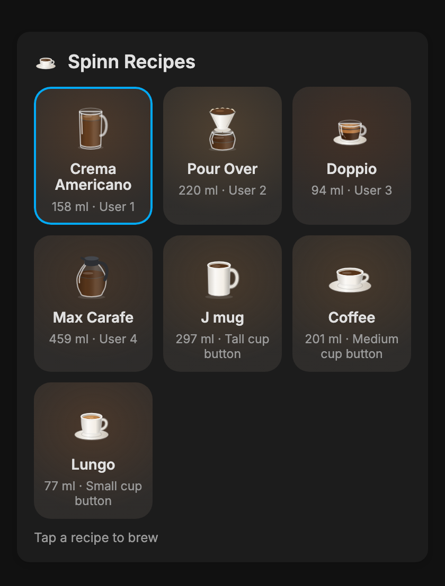
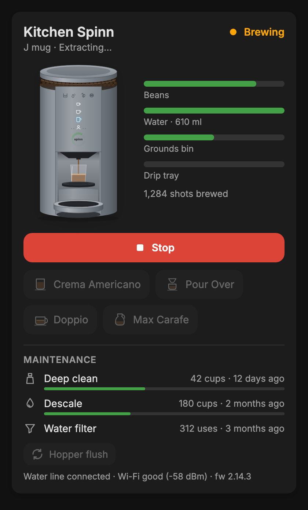
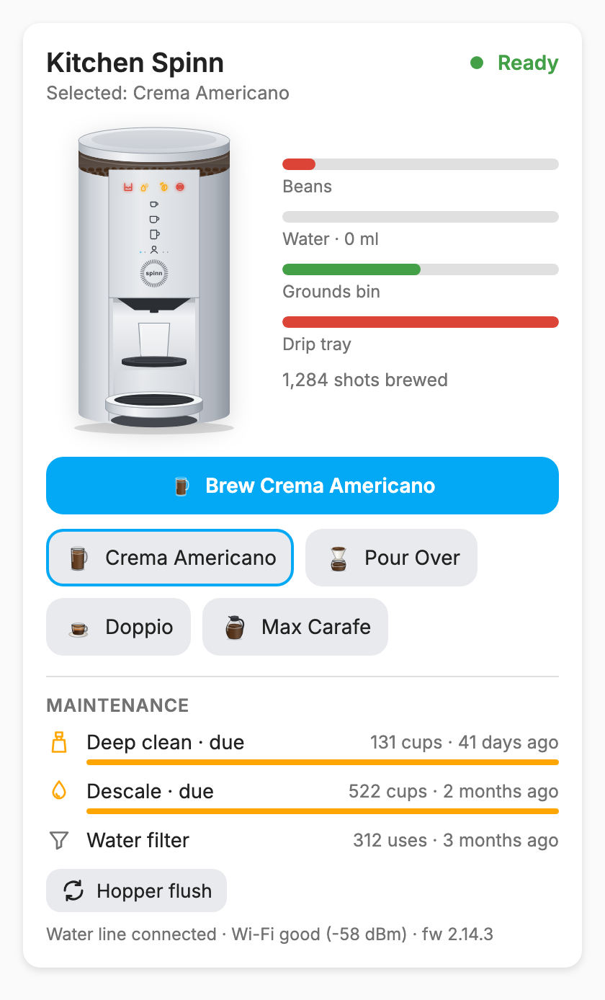
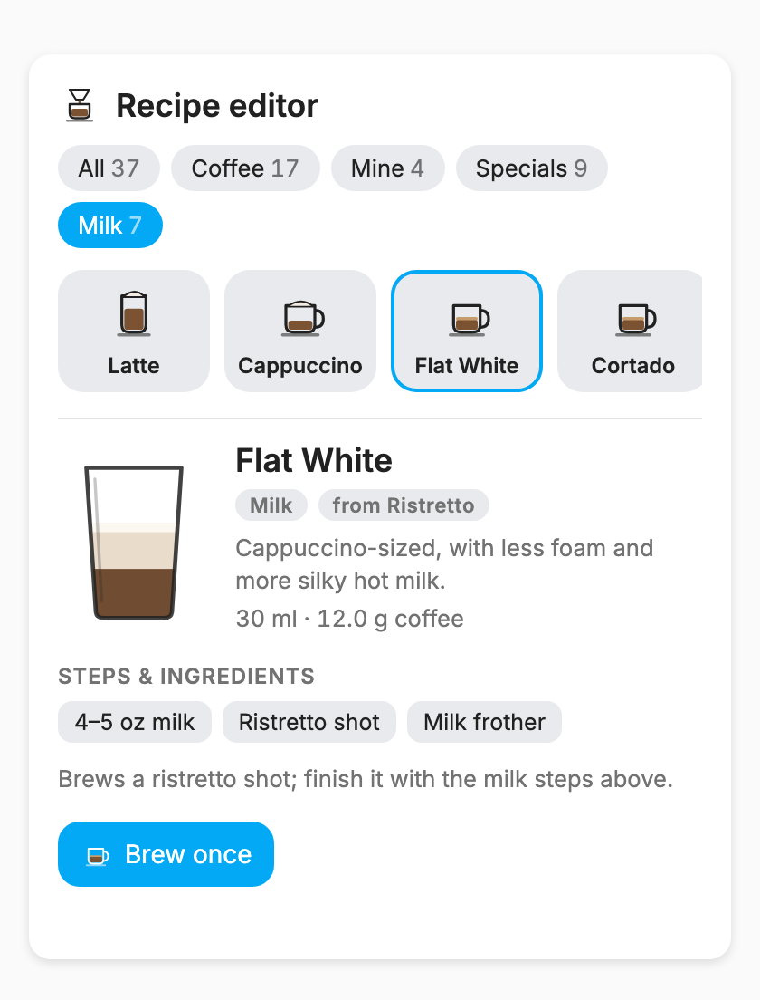

# DizzyCoffee

Local, app-free control for the **Spinn** bean-to-cup coffee maker — so you can read its
state and brew from your own tools (e.g. [Home Assistant](https://www.home-assistant.io/))
instead of the vendor's phone app.

[](https://ko-fi.com/spiegela)

> **Status:** **live-verified end to end** against a real machine — sign-in, device + certificate
> fetch, AWS IoT mutual-TLS, reading the shadow, **and brewing** (a client-issued `SELECT`+`PREPARE`
> made the machine pour) all work ([`docs/PROTOCOL.md`](docs/PROTOCOL.md)). Commands are
> confirmation-gated; use `--dry-run` to preview the exact bytes.

## What this is

Spinn machines are AWS IoT Core appliances. The phone app signs you in, fetches a per-user
X.509 client certificate for *your* machine, and talks to it over MQTT (mutual TLS). DizzyCoffee
does the same handshake from Python, with **your own account**, so nothing here depends on any
third-party cloud but Spinn's (the same one the app already uses). A fully-local, no-Spinn-cloud
mode is described in the protocol doc as a future tier.

Everything is driven by **your** credentials and **your** machine's certificate, fetched fresh
each session. No secrets are committed to this repo.

## Why

Right-to-repair / interoperability for a device you own. The vendor ships no local API, no Home
Assistant integration, and no documented protocol. This project documents the protocol and
provides a clean-room-style client so the machine you bought keeps working on your terms.

This is **not** affiliated with or endorsed by Spinn. "Spinn" is used only to name the device
this software interoperates with (nominative use).

## Layout

```
docs/PROTOCOL.md     Reverse-engineered protocol: auth, REST, MQTT, command wire format, shadow schema
dizzycoffee/         Python package
  config.py          Loads your credentials/config from env + local files (never the repo)
  api.py             Spinn REST client: login, token refresh, device + certificate, cookbook + recipes
  recipes.py         Recipe catalog, slot layout, and slider maths (grams/ml ↔ the app's 0–1 values)
  connection.py      AWS IoT mutual-TLS connection
  shadow.py          Read-only AWS IoT shadow reader; prints live machine state
  commands.py        Opt-in command path (brew, power, start/stop, flush)
  cli.py             `dizzy` command-line entry point
custom_components/spinn/  Home Assistant integration + dashboard cards
tests/               Integration and client tests (Home Assistant's test harness)
scripts/             deploy-to-ha.sh: put your checkout on a Home Assistant to try it
config.example.toml  Copy to ~/.config/dizzycoffee/config.toml and fill in, or use env vars
```

Working on the code? See [Development](#development).

## Quick start (read-only)

Requires [`uv`](https://docs.astral.sh/uv/). All deps are pulled on demand; nothing to install.

```bash
# 1. Sign in with YOUR Spinn account (credentials go straight to Spinn, stored locally only)
uv run python -m dizzycoffee login

# 2. List the machines on your account (and confirm the certificate came through)
uv run python -m dizzycoffee devices

# 3. Print your machine's live state (consumables, status, shot count…)
uv run python -m dizzycoffee state

# 4. Print your account's coffee stats exactly as Spinn returns them (JSON)
uv run python -m dizzycoffee stats
```

`stats` prints the two usage endpoints the app uses: `stats/api/user-stats` (servings per recipe,
which the Home Assistant **Servings** sensor shows) and `average-consumer/api/coffee-backlog` (bean
orders from Spinn's shop).

The login step writes a session token to `~/.config/dizzycoffee/session.json` (outside this
repo). The device certificate is fetched fresh each run and never written to disk.

### Read vs. command paths

`state` and `devices` only **read** (`shadow/get`, `shadow/update/documents`) and cannot actuate the
machine — the read and command paths live in separate modules (`shadow.py` vs `commands.py`).

## Commands (opt-in — these actuate your machine)

Every command below publishes to the device's command topic and **physically drives the machine**.
Each one is gated: it prints what it will send and waits for you to type `YES` (or pass `--yes` for
scripts). Use `--dry-run` first to see the exact hex without connecting to anything.

```bash
# See the wire bytes for a brew of slot 4 (the tall cup button) — sends nothing:
uv run python -m dizzycoffee brew --slot 4 --dry-run

# Actually brew slot 4 (prompts for confirmation; stand at the machine):
uv run python -m dizzycoffee brew --slot 4

uv run python -m dizzycoffee power on|off     # switch on / off
uv run python -m dizzycoffee start | stop     # start / stop
uv run python -m dizzycoffee flush            # hopper flush
uv run python -m dizzycoffee send --hex 0602  # raw escape hatch
```

> **Verified:** `brew` (`SELECT_RECIPE` then `PREPARE_RECIPE`) pours, and `--slot N` maps to the
> shadow's `RecipeNumber N` (slots 0–3 are the user dots, 4/5/6 the tall/medium/small cup buttons;
> see [Cookbook slots](#cookbook-slots)). `--sequence prepare` sends `PREPARE_RECIPE` alone if you want to try it.
> `power`/`start`/`stop`/`flush` opcodes are confirmed from the app but their individual effects
> aren't separately exercised yet. Details in [`docs/PROTOCOL.md`](docs/PROTOCOL.md).

## Home Assistant integration

A native custom integration lives in [`custom_components/spinn/`](custom_components/spinn/).
It reuses this repo's live-verified client (`dizzycoffee`) rather than reimplementing the
protocol: config-flow sign-in → device + certificate fetch → an AWS IoT **shadow push**
subscription (`cloud_push`) with a periodic re-read as a fallback.

<table>
  <tr>
    <td></td>
    <td></td>
    <td></td>
  </tr>
</table>

### Features

- **Live machine state, pushed** — status, brewing/cleaning/error, consumable levels, counters,
  and the installed cookbook update within a second or two of the machine changing.
- **Brew from Home Assistant** — any cookbook slot, or **any recipe at all** (specials, milk
  drinks, unsaved tweaks) through the machine's temporary slot, without touching your cookbook.
  A brew only reports success once the machine is actually pouring; otherwise you get an error
  saying why (offline, busy, empty tank, full drip tray, …).
- **Automation hooks** — a **Brew** event (started / finished / failed, for brews started
  anywhere) and a single **Needs attention** sensor that lists what to refill, empty or clean.
- **Recipe editor** — every recipe on your account with its real adjustable ranges; save
  your own versions and install them on the machine's buttons.
- **Maintenance at a glance** — cups since deep clean / descale, filter uses, and when each was
  last done, with reminder intervals you set in the integration's options.
- **Power switch** (opt-in, see below) to wake the machine or switch it off.
- **Three theme-aware dashboard cards**, registered automatically.
- **Diagnostics download** with tokens, certificate, serial and MAC addresses removed, for
  bug reports.
- **No password stored** — sign-in is exchanged for a session token; the device certificate is
  fetched fresh each cycle and never written to disk.

### Entities

Entity ids are `<domain>.<device>_<name>`, e.g. `sensor.kitchen_spinn_beans`. Items marked
*diagnostic* sit in the device page's Diagnostic section.

**Sensors**

| Entity | What it reports |
|---|---|
| Machine status | `READY`, `PREPAREDRINK`, `CLEANING`, `EXPELL`, `MACHINEERROR`, … (enum) |
| Process status | Current step while brewing or cleaning (enum), *diagnostic* |
| Beans | Hopper fill level |
| Water tank | Tank fill level |
| Water volume | Water in the tank (ml) |
| Water line status | Plumbed-in water line state, *diagnostic* |
| Grounds bin · Grounds bin capacity | Grounds bin fill, and its capacity *(diagnostic)* |
| Drip tray · Drip tray capacity | Drip tray fill, and its capacity *(diagnostic)* |
| Recipe number | Slot of the recipe last selected on the machine |
| Shot count | Lifetime shots brewed |
| Cups since deep clean · Cups since descale | Maintenance counters, *diagnostic*. Attribute `interval`: the cups between them set in the [options](#options) (0 = no reminder). |
| Filter counter | Uses since the water filter was changed, *diagnostic* |
| Grinder user counter · Grinder master counter | Grinder counters, *diagnostic* |
| Cold brew counter | Cold brews made, *diagnostic* |
| Last cleaning · Last descaling · Last filter change | Timestamps, *diagnostic* |
| Wi-Fi signal · Air pressure | dBm / sensor reading, *diagnostic*, disabled by default |
| Servings | Drinks made on your Spinn account, from Spinn's stats (total, increasing). Attributes `top_recipe` and `recipes` (each recipe's count, most brewed first). Re-read every 15 min and shortly after each brew. Account-wide: two machines on one account show the same totals. |
| Recipe catalog | Count of recipes; attributes `recipes` (every recipe with its values and adjustable ranges) and `cookbook` (what's in each slot). Used by the recipe editor; not recorded to history. |

**Binary sensors**

| Entity | On when |
|---|---|
| Connected | The machine is online to Spinn's cloud, *diagnostic* |
| Brewing | `MachineStatus` is `PREPAREDRINK` |
| Cleaning | `MachineStatus` is `CLEANING` or `EXPELL` (rinse / flush) |
| Error | `MachineStatus` is `MACHINEERROR` |
| Needs attention | Something needs doing: water or beans empty, grounds bin or drip tray full or out, deep clean or descale due, or a machine error. Attribute `reasons` lists what turned it on; `warnings` lists heads-ups that don't (water/beans low, bin/tray nearly full). |

`reasons`: `machine_error`, `water_tank_empty`, `beans_empty`, `grounds_bin_full`,
`grounds_bin_removed`, `drip_tray_full`, `drip_tray_removed`, `deep_clean_due`, `descale_due`.
`warnings`: `water_tank_low`, `beans_low`, `grounds_bin_nearly_full`, `drip_tray_nearly_full`. The
rules match the machine card's status icons. Deep clean and descale are due after 100 and 500 cups
by default; change that in the [options](#options).

**Event**

| Entity | Fires |
|---|---|
| Brew | `started` when the machine begins pouring, `finished` when it stops (including after **Stop**), `failed` if it goes from pouring to an error. Brews started from the machine's buttons or the Spinn app count too. Event data: `slot`, `recipe`, `recipe_id`, and `duration_s` on finished / failed. |

```yaml
# e.g. tell me when my coffee's ready
triggers:
  - trigger: state
    entity_id: event.kitchen_spinn_brew
    attribute: event_type
    to: finished
actions:
  - action: notify.mobile_app_phone
    data:
      message: "{{ trigger.to_state.attributes.recipe or 'Coffee' }} is ready ☕"
```

**Buttons** — *these actuate your machine*

| Entity | Does |
|---|---|
| Brew | Brews the slot chosen in **Recipe slot** |
| Start · Stop | Start / stop the current operation |
| Hopper flush | Runs a hopper flush |

Commands are refused, with an error saying why, while the shadow reports the machine **offline**
(otherwise the cloud would accept a brew for a switched-off machine and nothing would happen).
**Brew** and **Hopper flush** are also refused while the machine is busy (brewing, cleaning,
rinsing, recovering); **Stop** always goes through while it's online. **Brew** waits for the
machine to report that it's pouring: if it reports an error, or hasn't started within 60 s, the
press fails with whatever the machine says needs attention ("the water tank is empty").

Commands run one at a time, so a double-tapped **Brew** pours once (the second press finds the
machine busy). **Stop** never waits behind another command. Commands go out over the connection
the integration already holds for live updates, so there's no new connection per press; if that
connection is down they use a short-lived one instead.

**Switch** — *actuates your machine; disabled by default*

| Entity | Does |
|---|---|
| Power | On while the machine is awake, off while it's asleep or in standby (`MachineStatus` `INACTIVE` / `STANDBY`). Turning it on sends `SWITCH_ON`, off sends `SWITCH_OFF`. Off is refused mid-task. Unavailable while the machine is offline. |

> **Why it's disabled:** the power opcodes come from the app but haven't been tested on a
> machine yet. If `SWITCH_OFF` turned the machine fully off, Wi-Fi included, Home Assistant
> couldn't switch it back on. Try it once while you're standing next to the machine before you
> rely on it: enable it on the device page (**Entities → Power → Enable**).

**Select**

| Entity | Does |
|---|---|
| Recipe slot | Picks which cookbook slot **Brew** pours. Local only: changing it sends nothing. Attributes list each slot's recipe. |

### Cookbook slots

Every machine has 8 slots. The number is what the Brew button, the select and the services use,
and it equals the shadow's `RecipeNumber`:

| Slot | On the machine |
|---|---|
| 0–3 | The four user dots next to the person icon |
| 4 | Tall cup button |
| 5 | Medium cup button |
| 6 | Small cup button |
| 7 | Temporary slot, used for one-off brews (not user-assignable) |

### Services

All four take an optional `device_id`, needed only if you have more than one Spinn. Recipe ids
come from the **Recipe catalog** sensor's `recipes` attribute (they're specific to your account).

| Service | Does | Fields |
|---|---|---|
| `spinn.brew_recipe` | **Brews** any recipe once via the temporary slot. *Actuates the machine.* Same checks as the Brew button: refused when offline or busy (before anything is staged), and returns only once the machine is pouring. | `recipe_id`, optional `strength_g`, `size_ml`, `balance_pct`, `coffee_first` |
| `spinn.save_recipe` | Saves an adjusted copy as your own recipe, optionally installing it. Returns `{id, name, slot}`. | `base_recipe_id`, `name`, optional `slot` (0–6) + the same values |
| `spinn.install_recipe` | Puts an existing recipe into a slot | `recipe_id`, `slot` (0–6) |
| `spinn.delete_recipe` | Deletes one of your custom recipes (refused if it's installed in a slot) | `recipe_id` |

Values outside a recipe's range are clamped to it. Specials and milk drinks are fixed (brew-only);
milk drinks pour their ristretto base and leave the milk to you.

```yaml
# e.g. a morning automation
action: spinn.brew_recipe
data:
  recipe_id: o2MjNtPRAnC8PA1e1z068   # your Americano's id, from the Recipe catalog sensor
  strength_g: 15
  size_ml: 240
```

### Install

**Home Assistant 2026.11 and later (Marketplace):**

1. **Settings → Marketplace → Add from link**, enter `spiegela/dizzycoffee`, and choose type
   **Integration** if asked. (Custom repositories need a one-time GitHub sign-in.)
2. Install **Spinn Coffee Maker**. Setup starts straight away; sign in with your Spinn account,
   and pick a machine if the account has more than one.

**Older versions (HACS):** HACS → **⋮** → *Custom repositories*, add
`https://github.com/spiegela/dizzycoffee` as an **Integration**, install **Spinn Coffee Maker**,
restart, then **Settings → Devices & Services → Add Integration → Spinn**.

> **Bundled client — nothing extra to install.** The integration ships a verbatim copy of the
> `dizzycoffee` client under
> [`custom_components/spinn/_vendor/`](custom_components/spinn/_vendor/), so Marketplace and HACS installs
> (including Home Assistant OS) work out of the box; `awsiotsdk` installs automatically from the
> manifest, and `requests` / `certifi` already come with Home Assistant. If a real `dizzycoffee` is already
> importable in your HA environment (e.g. a development checkout) it is preferred, and the
> bundled copy is used only as a fallback. See the
> [`_vendor/` README](custom_components/spinn/_vendor/README.md) for how to re-sync the copy
> after changing the client.

### Dashboard cards

The integration ships three theme-aware Lovelace cards (in
[`custom_components/spinn/frontend/`](custom_components/spinn/frontend/)) and **registers
them automatically** — no manual resource step. Edit a dashboard → **Add card** → search
"Spinn". Each card finds the first Spinn device's entities on its own.

#### Spinn Machine — `custom:spinn-machine-card`

<table>
  <tr>
    <td></td>
    <td></td>
    <td></td>
  </tr>
  <tr><td align="center">Ready</td><td align="center">Brewing (dark theme)</td><td align="center">Needs attention</td></tr>
</table>

An illustration of the machine that tracks it live: the hopper's beans drop with the level, the
status icons light up when water, drip tray or grounds need you, the glass fills while brewing,
and the spinn ring sweeps green while it works. Beside it are level bars and the shot count.
Below: one **Brew** button (it becomes **Stop** while busy), favorite chips, and a
**Maintenance** section with deep-clean / descale / filter progress, a Hopper flush button,
and water-line, Wi-Fi and firmware details. The cup buttons drawn on the machine are tappable
and brew whatever is in those slots.

```yaml
type: custom:spinn-machine-card
name: Kitchen Spinn        # optional title (default: the device name, prefixed with "Spinn" if it lacks it)
favorites: [0, 1, 2, 3]    # slots to show as chips (names/icons come from the cookbook)
# favorites:               # or spell them out
#   - { slot: 4, name: Morning mug, icon: mug }
# machine_buttons: { small: 6, medium: 5, tall: 4 }   # default: from the cookbook; false = off
# deep_clean_every: 100    # cups between deep cleans (default: the integration's options)
# descale_every: 500       # cups between descales (default: the integration's options)
# maintenance: false       # hide the maintenance section
# confirm: true            # ask before each brew
# prefix: kitchen_spinn    # entity slug, if auto-detect guesses wrong
```

#### Spinn Recipes — `custom:spinn-recipe-card`

<table>
  <tr>
    <td></td>
    <td></td>
  </tr>
</table>

Tap a tile to brew it. The **On machine** tab (the default) shows what's installed in the
seven cookbook slots, with names, sizes and which button each sits on, and brews by slot. The
**All / Coffee / Mine / Specials / Milk** tabs show every Spinn recipe; tapping one that isn't
installed brews it once through the temporary slot (`spinn.brew_recipe`), so your cookbook isn't
changed. Milk drinks pour their ristretto base and remind you to add the milk. A dot marks
recipes that are installed.

```yaml
type: custom:spinn-recipe-card
# title: Spinn Recipes     # default
# tab: special             # start on: machine (default) | all | coffee | custom | special | milk
# tabs: false              # only the installed slots, no tabs
# recipes: [4, 5, 6]                                       # just these slots (hides the tabs)
# recipes:
#   - { slot: 0, name: Crema Americano, icon: americano }  # or override names/icons
# confirm: true
```

#### Spinn Recipe Editor — `custom:spinn-recipe-editor-card`

<table>
  <tr>
    <td></td>
    <td></td>
    <td></td>
  </tr>
  <tr><td align="center">Your recipe</td><td align="center">Specials</td><td align="center">Milk drinks</td></tr>
</table>

Every recipe the Spinn app offers: the stock coffees, your own, the specials (with their
ingredient lists) and the milk drinks. Filter by type, pick one, and adjust **strength**,
**size**, **water balance** and **pour order** within that recipe's real ranges; the cup
preview follows along. Then:

- **Brew once** — pours it now, adjusted, without changing your cookbook (`spinn.brew_recipe`).
- **Save as…** — keeps it as your own recipe, optionally straight onto a slot (`spinn.save_recipe`).
- **Put in slot…** — installs a recipe onto a user dot or cup button (`spinn.install_recipe`).
- **Delete** — removes one of your custom recipes, after a confirmation step.

```yaml
type: custom:spinn-recipe-editor-card
# title: Spinn Recipe Editor   # default
# filter: custom           # start on: all | coffee | custom | special | milk
# confirm: true            # ask before Brew once
```

Every recipe is drawn as its own illustration (picked from the recipe's Spinn slug), with an
accent colour behind each tile; in the editor the picture follows strength, size and pour order.
To choose a drawing yourself, set `icon` on a favorite or recipe tile: `espresso`, `ristretto`,
`espressoplus`, `doppio`, `lungo`, `americano`, `coffee`, `mug`, `xlbold`, `carafe`,
`travelmug`, `tumbler`, `pourover`, `water`, `coldbrew`, `nitro`, `coldespresso`, `latte`,
`vanillalatte`, `cappuccino`, `flatwhite`, `cortado`, `macchiato`, `mocha`, `affogato`,
`barraquito`, `romano`, `martini`, `guillermo`, `holiday`, `icedcappuccino`, `moonlight`,
`pumpkin`. Any entity can be overridden in YAML by its key (e.g. `beans: sensor.my_beans`).

If you ever disable auto-registration, add the module manually as a dashboard resource:
`/spinn_cards/spinn-card.js` (JavaScript module).

### Options

**Settings → Devices & Services → Spinn → Configure** sets how many cups go between deep cleans
(default 100) and between descales (default 500); 0 turns a reminder off. They drive
`deep_clean_due` / `descale_due` on **Needs attention**, the `interval` attribute on the
cups-since counters, and the maintenance bars on the Spinn Machine card. Changes apply straight
away, with no reload.

### Diagnostics

**Settings → Devices & Services → Spinn → ⋮ → Download diagnostics** saves a JSON file with
the machine's live state, the device record, the installed cookbook, the recipe catalog, the
connection status, what **Needs attention** sees, the maintenance intervals, and a live read of
your account's coffee stats (the same endpoints as `dizzy stats`). The session token, email, device
certificate and key, serial number, MAC addresses, Wi-Fi details and the machine's thing name
are removed, so it's safe to attach to an issue.

> Publishing to `<thing>/host` **actuates the machine**. The Brew/Start/Stop/Flush buttons, the
> Power switch, the recipe tiles, the machine's drawn cup buttons, **Brew once** and `spinn.brew_recipe` all do
> exactly that — treat them like pressing the machine's own buttons. Saving, installing and
> deleting recipes change your Spinn account's cookbook but never start a brew.

## Development

Contributions are welcome. This section covers getting set up, where things live, testing, trying a
branch on a real Home Assistant, and the rules the code follows.

### Setup

You need [`uv`](https://docs.astral.sh/uv/) and Python 3.14 for the tests (CI uses 3.14; the client
itself runs on 3.11+).

```bash
git clone https://github.com/spiegela/dizzycoffee && cd dizzycoffee
uv venv --python 3.14
uv pip install -r requirements_test.txt      # Home Assistant's test harness + the client's deps
.venv/bin/python -m pytest                   # should be all green before you change anything
```

The client CLI needs no install: `uv run python -m dizzycoffee <command>`. It reads optional settings
from `~/.config/dizzycoffee/config.toml` or `DIZZY_*` environment variables (see
[`config.example.toml`](config.example.toml)). Your session token lives in
`~/.config/dizzycoffee/session.json`, never in the repo.

Handy for protocol work, all read-only: `uv run python -m dizzycoffee state --watch --raw` streams
the full shadow, `… stats` prints the usage endpoints, and `--dry-run` on any actuating command
shows the exact bytes without connecting.

### Where things live

| Path | What's there |
|---|---|
| `dizzycoffee/` | The client: REST (`api.py`), MQTT connection (`connection.py`), read-only shadow (`shadow.py`), the actuating command path (`commands.py`), recipe maths (`recipes.py`), CLI (`cli.py`) |
| `custom_components/spinn/coordinator.py` | Everything the integration knows: the push stream and fallback poll, the command path and its guards, recipe operations, usage stats |
| `custom_components/spinn/{sensor,binary_sensor,button,select,switch,event}.py` | One file per entity platform; entities read from the coordinator |
| `custom_components/spinn/attention.py`, `stats.py` | Pure logic (Needs attention rules, stats parsing), easy to unit-test |
| `custom_components/spinn/config_flow.py` | Sign-in, machine picker, reauth, options |
| `custom_components/spinn/diagnostics.py` | The redacted diagnostics download |
| `custom_components/spinn/services.py`, `services.yaml` | The `spinn.*` recipe services |
| `custom_components/spinn/strings.json`, `translations/en.json` | Entity, config-flow and options text |
| `custom_components/spinn/frontend/spinn-card.js` | The three dashboard cards: plain JavaScript, no build step |
| `custom_components/spinn/_vendor/` | A verbatim copy of the client, so HACS installs work (see below) |
| `tests/` | `conftest.py` stubs Spinn's cloud; one test file per area |

### Tests

Tests use Home Assistant's own test harness with Spinn's cloud stubbed out, so they never touch
the network or a machine. `tests/conftest.py` swaps the coordinator's sign-in / fetch / shadow
read (`_refresh_blocking`) for canned data. Its fixtures:

- `coordinator`: an online, idle machine. `setup_spinn(**shadow)` gives you other starting states,
  e.g. `await setup_spinn(MachineStatus="PREPAREDRINK")`.
- `coordinator.async_set_updated_data({...})` changes state the same way a pushed shadow update
  does.
- Patch `coordinator._send_blocking` (the MQTT publish) for anything that would actuate the machine,
  and give it a side effect that pushes the machine's reaction, as in `tests/test_commands.py`.

Every behaviour change comes with a test. For a guard or safety check, make sure the test fails if
you delete the check. `node --check custom_components/spinn/frontend/spinn-card.js` syntax-checks
the cards. `uvx ruff check --select F,B custom_components dizzycoffee tests` catches unused imports
and common bugs; CI doesn't enforce it yet.

### Trying a branch on your Home Assistant

Tests can't tell you how the real machine reacts. `scripts/deploy-to-ha.sh` puts your checkout on a
Home Assistant (`--help` for every option).

**Kubernetes** — copies the files into the Home Assistant pod with `kubectl exec`:

```bash
export HA_URL=https://ha.example.com HA_TOKEN=…   # a long-lived token: your profile → Security
scripts/deploy-to-ha.sh k8s -n home-assistant              # finds app.kubernetes.io/name=home-assistant
scripts/deploy-to-ha.sh k8s -n home deploy/home-assistant  # or name a pod / deploy / statefulset, or -l
```

With `HA_URL` and `HA_TOKEN` set it restarts Home Assistant in place through its API: config check
first, then waits for it to come back and reports whether the Spinn entry loaded. Without them it
deletes the pod so its Deployment or StatefulSet replaces it, then checks the files survived (they
won't if an init container or the image resets `custom_components`; use the API restart then).
`-c CONTAINER` picks the container if the pod has sidecars, `--context` the cluster.

**SSH** — e.g. the **Terminal & SSH** add-on on Home Assistant OS, with your key added:

```bash
scripts/deploy-to-ha.sh ssh root@homeassistant.local        # add a port if it isn't 22
```

Either way the files land in `/config/custom_components/spinn` (`HA_CONFIG` if your config lives
elsewhere), the copy they replace is kept in `/config/.dizzycoffee/spinn.bak`, and `NO_RESTART=1`
skips the restart. Redownloading in HACS / Marketplace puts the released version back.

### Guidelines

**Safety first: this drives a real appliance.**
- Reading and actuating stay separate. Only `dizzycoffee/commands.py` publishes to `<thing>/host`;
  `shadow.py` and the integration's read path never do.
- In the integration, every actuation goes through the coordinator's command methods. They refuse
  while the machine is offline or busy (`_ensure_online`, `_ensure_idle`) and run one at a time
  (`_command_lock`; only Stop skips it). New actuating features use the same path; don't publish
  from an entity.
- CLI commands that actuate stay confirmation-gated (`YES` or `--yes`) and support `--dry-run`.
- Nothing retries an actuating publish: a retry could brew twice.
- Behaviour that hasn't been tried on a machine ships off by default or clearly labelled, like the
  Power switch. Never point tests or CI at a real machine.

**Protocol facts carry their evidence.** [`docs/PROTOCOL.md`](docs/PROTOCOL.md) tags each claim:
**[C]** confirmed from the decompiled app, **[L]** still to verify live, **[V]** live-verified
(with the date). When you verify something on your machine, upgrade its tag and note what you saw.
Don't change verified timings (like the ~4 s between brew steps) without a live test.

**Privacy.**
- No credentials, tokens, certificates or captured personal data in the repo; `.gitignore` covers
  the usual files.
- The device certificate is fetched fresh and never written to disk; keep it that way.
- New fields from Spinn that could identify someone must be redacted in `diagnostics.py`, and
  `tests/test_diagnostics.py` checks for leaks. Strip ids, emails and serials from anything you
  paste into an issue.

**The bundled client.** HACS installs only get `custom_components/spinn/`, so the integration ships
a copy of the client in `_vendor/`. After changing `dizzycoffee/{__init__,api,connection,commands,recipes}.py`:

```bash
cp dizzycoffee/{__init__,api,connection,commands,recipes}.py custom_components/spinn/_vendor/dizzycoffee/
```

`tests/test_vendor_sync.py` fails until you do.

**Home Assistant conventions.**
- The client is synchronous: call it through `hass.async_add_executor_job`, and import it lazily
  inside methods, as the existing code does. MQTT callbacks arrive on an awscrt thread; hand them
  to the event loop with `hass.loop.call_soon_threadsafe`.
- Every entity has a `translation_key` with text in `strings.json`. `translations/en.json` is an
  identical copy; change both.
- Keep working on the minimum Home Assistant in `hacs.json` (2024.11.0). For example, the options
  flow looks up its entry with `self.handler` because `self.config_entry` only arrived in 2024.12.
- Don't add packages Home Assistant already ships (`requests`, `certifi`) to the manifest's
  `requirements`; hassfest rejects them.

**Versions.**
- Bump `version` in `custom_components/spinn/manifest.json` for integration changes.
- When the cards change, bump `CARD_VERSION` in both `const.py` and `frontend/spinn-card.js`, so
  browsers load the new file.
- Raise `homeassistant` in `hacs.json` if you start relying on a newer Home Assistant.

**Docs.** User-facing changes update this README: the entity tables, services, card options and
examples. Protocol discoveries go in `docs/PROTOCOL.md`.

### Pull requests and CI

- Keep pull requests focused, and say why as well as what.
- Say what you verified on a real machine and what's covered only by tests.
- CI (`.github/workflows/ci.yml`) must be green. It runs the tests (Python 3.14, Home Assistant
  2026.10), **hassfest** and **HACS** validation on every pull request and push to `main`, plus a
  weekly run.

## Credits

Protocol recovered by static analysis of the official Android app for personal interoperability.
Inspired by the community "Project Spunn" discussion, which stayed private.

## Support

If DizzyCoffee freed your Spinn from the app, a coffee is always appreciated — no pressure, the
project stays free and open either way.

[](https://ko-fi.com/spiegela)

## License

MIT — see [`LICENSE`](LICENSE).
